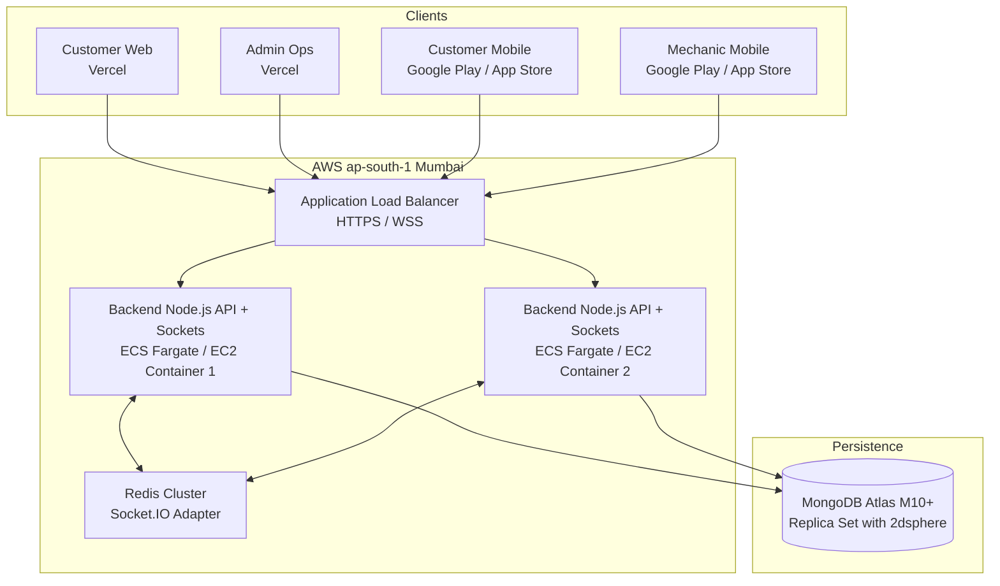

# 10Min Help — Production Deployment Guide

This guide details deployment procedures for 10Min Help across cloud infrastructure, databases, payment gateways, and mobile app stores.

---

## 1. Cloud Infrastructure & Hosting Topology



---

## 2. MongoDB Atlas Configuration

1. **Cluster Provisioning**:
   - Provision an M10 or higher tier cluster located in **AWS ap-south-1 (Mumbai)** to maintain &lt;10ms database latency for Indian cities.
2. **Network Security**:
   - Add IP access list rules or configure AWS VPC Peering.
3. **Indexes**:
   - Ensure the following geospatial and compound indexes are active:
     - `TechnicianModel`: `{ "currentLocation.coordinates": "2dsphere" }`
     - `TechnicianModel`: `{ "isOnline": 1, "verificationStatus": 1 }`
     - `BookingModel`: `{ "pickupLocation.coordinates": "2dsphere" }`
     - `BookingModel`: `{ "customer": 1, "status": 1 }`

---

## 3. Backend Production Deployment

### Docker Containerization
A production multi-stage `Dockerfile`:
```dockerfile
FROM node:20-alpine AS builder
WORKDIR /app
COPY package*.json ./
COPY packages ./packages
COPY backend ./backend
RUN npm ci
RUN npm run build:shared
RUN npm run build:backend

FROM node:20-alpine AS runner
WORKDIR /app
ENV NODE_ENV=production
COPY --from=builder /app/package*.json ./
COPY --from=builder /app/packages/shared/dist ./packages/shared/dist
COPY --from=builder /app/packages/shared/package.json ./packages/shared/
COPY --from=builder /app/backend/dist ./backend/dist
COPY --from=builder /app/backend/package.json ./backend/
RUN npm ci --omit=dev
EXPOSE 5001
CMD ["node", "backend/dist/server.js"]
```

### Process Management with PM2
```bash
pm2 start backend/dist/server.js --name "10min-help-api" -i max
```

---

## 4. Web Applications Deployment (Vercel)

1. **Customer Web**:
   - Root directory: `apps/customer-web`
   - Build Command: `npm run build`
   - Environment Variables:
     - `NEXT_PUBLIC_API_URL=https://api.10minhelp.in/api/v1`
     - `NEXT_PUBLIC_SOCKET_URL=https://api.10minhelp.in`
2. **Admin Operations Web**:
   - Root directory: `apps/admin-web`
   - Build Command: `npm run build`
   - Environment Variables:
     - `NEXT_PUBLIC_API_URL=https://api.10minhelp.in/api/v1`
     - `NEXT_PUBLIC_SOCKET_URL=https://api.10minhelp.in`

---

## 5. Mobile Applications Deployment (Expo EAS)

### Customer Mobile App
```bash
cd apps/customer-mobile
eas build --platform all --profile production
eas submit --platform android
eas submit --platform ios
```

### Mechanic Mobile App
```bash
cd apps/mechanic-mobile
eas build --platform all --profile production
eas submit --platform android
eas submit --platform ios
```

*Note: iOS requires Apple Developer Program registration and background location disclosure (`NSLocationWhenInUseUsageDescription`). Android requires Fine Location permission disclosure for turn-by-turn road navigation.*

---

## 6. Payment Gateway (Razorpay India) Setup

1. Complete Razorpay Business KYC for automotive emergency services.
2. In Razorpay Dashboard, generate Live Key ID & Secret Key.
3. Configure Webhook URL:
   - URL: `https://api.10minhelp.in/api/v1/payments/webhooks/razorpay`
   - Secret: `<PAYMENT_WEBHOOK_SECRET>`
   - Subscribed Events: `payment.captured`, `payment.failed`, `refund.processed`.
